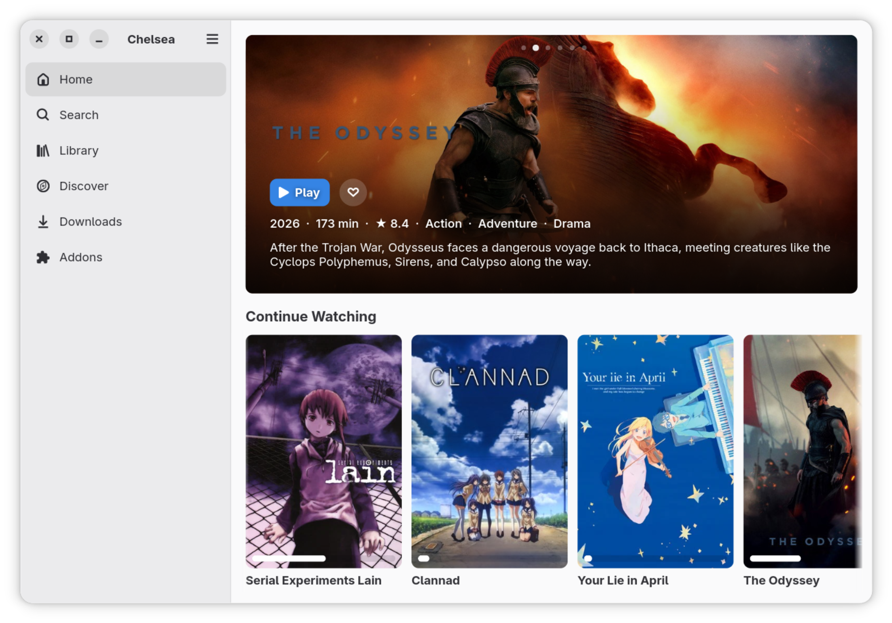
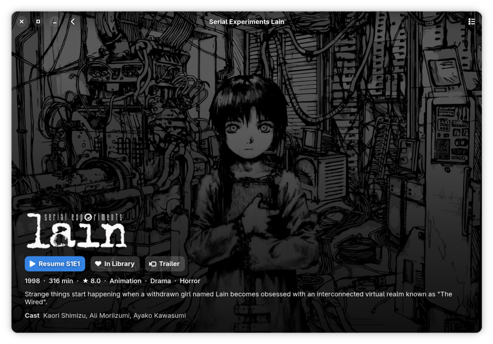
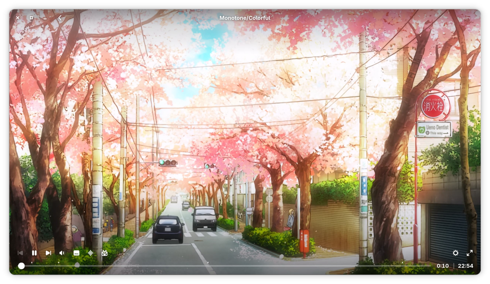
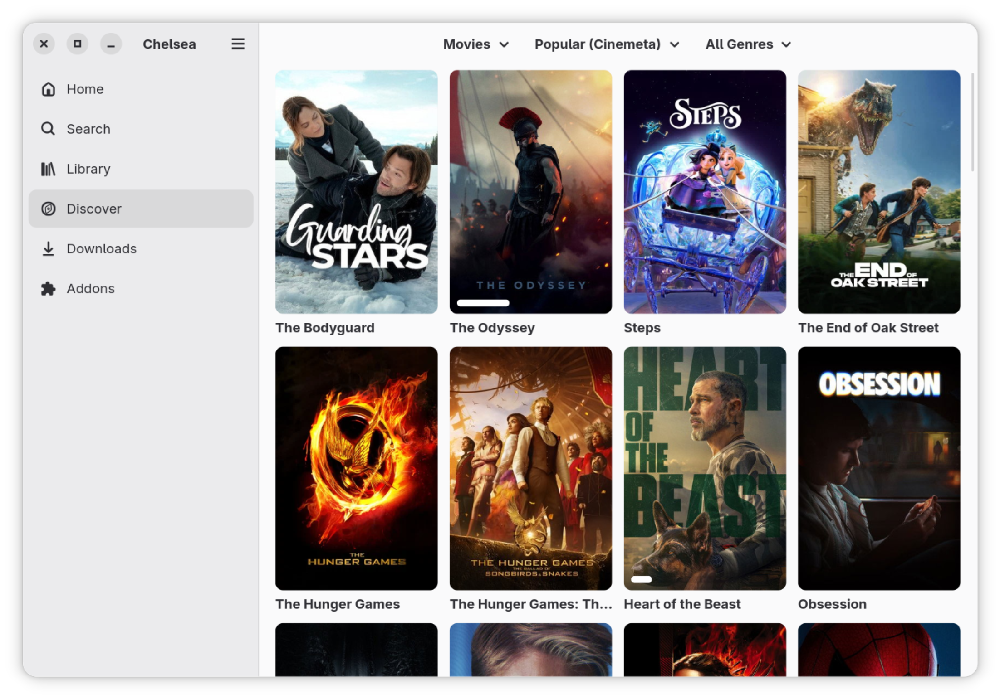

<h1 align="center">Chelsea</h1>

Chelsea lets you discover and watch movies and series from your Stremio addons, with a beautiful libadwaita UI and a built-in player.
(If anyone can make a better app icon please hit me up)
## Features

- A beautiful libadwaita UI that works on desktops, tablets and phones
- Catalogs, search and title pages from any Stremio addon
- A built-in mpv player with subtitles, chapters and seek bar previews
- Torrent streaming built in
- Downloads for offline viewing

Chelsea connects with [Stremio](https://www.stremio.com) and its addons, streams torrents with [Nuvio Engine](https://github.com/NuvioMedia/nuvio-engine), and plays everything with [mpv](https://mpv.io). The player is inspired by [Cine](https://github.com/diegopvlk/Cine).

  

### Installation
You can install Chelsea as a flatpak on Linux
<table>
  <tr>
  <td>
    

      
    

  </td>
  <td>
    

      
    

  </td>
  </tr>
</table>

## Screenshots

<table>
  <tr>
    <td align="center">
      
       
      <strong>Title Details</strong>
    </td>
    <td align="center">
      
       
      <strong>Player</strong>
    </td>
  </tr>
  <tr>
    <td align="center">
      
       
      <strong>Discover</strong>
    </td>
  </tr>
</table>

## Other Apps

<table>
  <tr>
    <td>
      
    </td>
    <td>
      <a href="https://flathub.org/en/apps/io.github.riyaniii.Kaori"><strong>Kaori</strong></a>
       
      Discover, download and read comics with a beautiful UI
       
      <a href="https://github.com/riyaniii/Kaori">GitHub</a>
    </td>
  </tr>
</table>

## Code of Conduct
This project follows the [GNOME Code of Conduct](https://conduct.gnome.org/)

## Special Thanks to
<table>
  <tr>
    <td>Diego Povliuk (for Cine, which the player is based on)</td>
  </tr>
  <tr>
    <td>Nuvio (for Nuvio Engine)</td>
  </tr>
</table>
